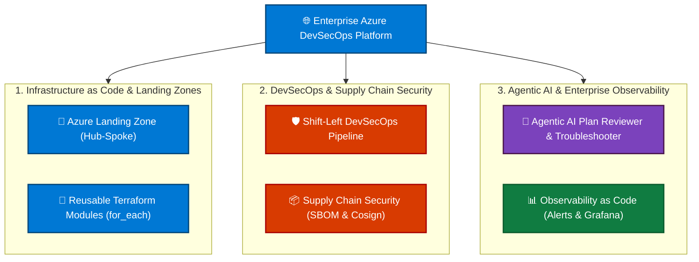
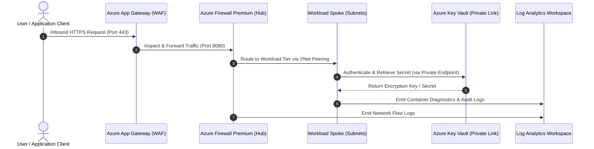

# 🌐 Enterprise Azure DevSecOps Platform

[](https://github.com/gunjankumargaurav7350/enterprise-azure-devsecops-platform/actions/workflows/ci-cd-platform-orchestrator.yml)
[](https://www.terraform.io/)
[](https://azure.microsoft.com/)
[](#)
[](#)
[](#)
[](LICENSE)

> **Architect & Lead Engineer**: [Gunjan Kumar Gaurav](https://github.com/gunjankumargaurav7350)  
> **Target Cloud**: Microsoft Azure (Enterprise Hub-Spoke Landing Zone)  
> **IaC Pattern**: 100% Modular Terraform with strict `for_each` collections  
> **Security Baseline**: Zero-Trust, Shift-Left DevSecOps (tfsec, Checkov, Trivy, TruffleHog, Cosign, Kyverno)

---

## 🧭 Executive Architecture Blueprint

The **Enterprise Azure DevSecOps Platform** is an enterprise-scale, production-ready reference platform uniting six foundational pillars of modern cloud engineering:



---

## 🧩 Architectural Repositories & Subsystem Matrix

This master umbrella repository unifies and orchestrates the following six specialized production-grade repositories:

| Subsystem / Pillar | Repository | Key Capabilities & Architecture | Primary Tech Stack |
| :--- | :--- | :--- | :--- |
| **1. Enterprise Landing Zone** | [`Azure-Landing-Zone-Terraform`](https://github.com/gunjankumargaurav7350/Azure-Landing-Zone-Terraform) | Hub-and-Spoke VNet peering mesh, Azure Firewall Premium, Azure Bastion, App Gateway WAF v2, Azure Policy enforcement. | Terraform, Azure CAF, UDR |
| **2. Modular IaC Library** | [`terraform-azure-modules`](https://github.com/gunjankumargaurav7350/terraform-azure-modules) | Zero-hardcoding reusable modules (VNet, NSG, Key Vault, RBAC) using strict `for_each`, Blob Lease state locking. | Terraform, HCL, Azure Blob Storage |
| **3. Shift-Left DevSecOps** | [`azure-devsecops-pipeline`](https://github.com/gunjankumargaurav7350/azure-devsecops-pipeline) | Azure DevOps multi-stage YAML + GitHub Actions with tfsec, Checkov, TFLint, Trivy, TruffleHog, and Terratest. (**30% security findings reduction**). | Azure Pipelines, GitHub Actions, Go |
| **4. Agentic AI Cloud SRE** | [`agentic-ai-terraform-reviewer`](https://github.com/gunjankumargaurav7350/agentic-ai-terraform-reviewer) | Autonomous AI agent for plan blast-radius scoring, CI/CD pipeline failure diagnostics, and human-in-the-loop approval gates. | Python, Click, Rich, LLM Agent |
| **5. Supply Chain Integrity** | [`supply-chain-security-sbom-cosign`](https://github.com/gunjankumargaurav7350/supply-chain-security-sbom-cosign) | Automated Syft SBOM generation, Grype/Trivy vulnerability gates, cryptographic Cosign signing, and Kyverno admission policies. | Syft, Cosign, Kyverno, Docker |
| **6. Observability as Code** | [`azure-observability-as-code`](https://github.com/gunjankumargaurav7350/azure-observability-as-code) | Centralized Log Analytics, dynamic Action Groups with `for_each`, Metric Alerts, Activity Log alerts, Azure Managed Grafana dashboards. | Terraform, Azure Monitor, Grafana |

---

## 🚀 Hub-and-Spoke Topology & Network Flow



---

## 🛠️ Repository Directory Layout

```text
enterprise-azure-devsecops-platform/
├── .github/
│   └── workflows/
│       └── ci-cd-platform-orchestrator.yml  # End-to-end multi-gate CI/CD orchestrator
├── docs/
│   ├── architecture.md                     # Deep-dive CAF architecture & network flow
│   ├── security-governance.md              # CIS Azure v2.0 & NIST 800-53 compliance matrix
│   ├── threat-matrix.md                    # Attack vector & defensive mitigation analysis
│   └── runbook.md                          # Production operations and disaster recovery
├── orchestration/
│   ├── deploy-all.sh                       # Enterprise Bash deployment orchestrator
│   ├── Deploy-All.ps1                      # Cross-platform PowerShell orchestrator
│   └── verify-platform.sh                  # Live health check & compliance verification
├── platform-blueprint/                     # Master Terraform landing zone configuration
│   ├── backend.tf                          # Azure Blob lease state locking
│   ├── versions.tf                         # Provider version locks (azurerm >= 3.116)
│   ├── variables.tf                        # Enterprise configuration schemas
│   ├── main.tf                             # Hub-Spoke, RBAC, Policy, KV, LAW with for_each
│   ├── outputs.tf                          # Endpoints, VNet IDs, and telemetry outputs
│   └── terraform.tfvars.example            # Production variables baseline
└── README.md                               # Project documentation & visual blueprints
```

---

## ⚡ Quick Start: Deploying the Platform

### Prerequisites
1. **Azure CLI** (`az login`) with Owner or Contributor + User Access Administrator on the target subscription.
2. **Terraform CLI** (`>= 1.5.0`).
3. Active Azure Storage Account configured for remote state backend.

### 1. Clone the Repository
```bash
git clone https://github.com/gunjankumargaurav7350/enterprise-azure-devsecops-platform.git
cd enterprise-azure-devsecops-platform
```

### 2. Configure Variables
```bash
cp platform-blueprint/terraform.tfvars.example platform-blueprint/terraform.tfvars
```

### 3. Automated Orchestration via Bash or PowerShell
Using Bash:
```bash
chmod +x orchestration/deploy-all.sh orchestration/verify-platform.sh
./orchestration/deploy-all.sh
```

Using PowerShell:
```powershell
Set-ExecutionPolicy -ExecutionPolicy RemoteSigned -Scope Process
.\orchestration\Deploy-All.ps1 -Environment "prod"
```

### 4. Verify Platform Health
```bash
./orchestration/verify-platform.sh
```

---

## 🔒 Security Quality Gates & Compliance

Every pull request triggers the automated **Platform CI/CD Orchestrator** executing 5 sequential shift-left quality gates:
1. **Format & Syntax Validation**: `terraform fmt -check` & `terraform validate`.
2. **IaC Security Scanning**: `tfsec` and `Checkov` ensuring 0 critical/high findings.
3. **Secret Leak Prevention**: `TruffleHog` analyzing git commit history.
4. **Agentic AI Evaluation**: AI agent reviews plan diff, scores blast radius, and flags risk.
5. **Supply Chain Gate**: `Syft` generates SPDX SBOM; `Cosign` signs artifacts; `Kyverno` validates admission policies.

---

## 👤 Author & Maintainer

**Gunjan Kumar Gaurav**  
Senior Azure DevOps & Cloud Security Platform Engineer  
- 💼 [GitHub Profile](https://github.com/gunjankumargaurav7350)  
- 📜 [LinkedIn Profile](https://www.linkedin.com/in/gunjankumargaurav)

---

## 📄 License
This project is licensed under the [MIT License](LICENSE).
