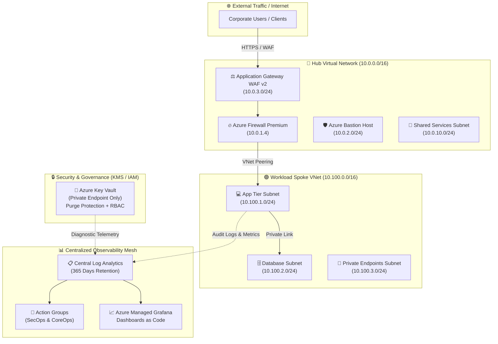

# 🏛️ Enterprise Azure Platform Architecture

## Executive Overview
The **Enterprise Azure DevSecOps Platform** provides a production-grade, highly secure, and compliant cloud landing zone built according to the **Microsoft Cloud Adoption Framework (CAF)** and **Well-Architected Framework (WAF)** principles.

---

## Core Pillars & Architectural Decisions

### 1. Hub-and-Spoke Network Topology
- **Hub Virtual Network (`10.0.0.0/16`)**: Acts as the central security and routing nexus. Houses Azure Firewall Premium, Azure Bastion for zero-public-IP VM administration, and Application Gateway with WAF v2 policies.
- **Spoke Virtual Network (`10.100.0.0/16`)**: Isolated workload environment connected via bi-directional VNet peering with non-overlapping address spaces.
- **Centralized Egress Routing**: Custom User Defined Routes (UDR) force all spoke outbound traffic (`0.0.0.0/0`) through the Hub Azure Firewall (`10.0.1.4`).

### 2. Zero-Trust Security & Identity
- **Private Link Exclusivity**: Public network access is strictly disabled on storage accounts and Azure Key Vault. All control and data planes communicate via Private Endpoints.
- **Role-Based Access Control (RBAC)**: Enforces Azure AD Least-Privilege access with no long-lived access keys.
- **Data Protection**: 90-day soft delete retention with hardware-enforced purge protection on all Key Vault instances.

### 3. Shift-Left Security Pipeline Gates
- **Static IaC Scanning**: Automated tfsec, Checkov, and TFLint gates scan every commit.
- **Secret Detection**: TruffleHog verifies no credentials or tokens are committed.
- **Container Scanning**: Trivy scans container images for CVEs before admission.
- **Terratest Automation**: Automated Go integration tests spin up ephemeral sandboxes to validate connectivity before production promotion.

### 4. Agentic AI Plan & Blast Radius Evaluation
- Automatically calculates blast radius score (0-100) on Terraform plans.
- Flags destructive resource deletions, security downgrades, or unintended route modifications.
- Generates structured Markdown pull request reviews with compliance sign-offs.

### 5. Supply Chain Integrity (SLSA Level 3)
- Generates Software Bill of Materials (SBOM) using Syft in SPDX format.
- Signs artifacts and manifests cryptographically with Sigstore Cosign.
- Enforces admission verification via Kyverno policies inside the cluster.

### 6. Observability as Code
- Unified telemetry routing to Central Log Analytics Workspace.
- Proactive multi-tier alerting for CPU, memory, database latency, and 5xx errors.
- Activity Log alerting for unauthorized privilege escalation attempts.
